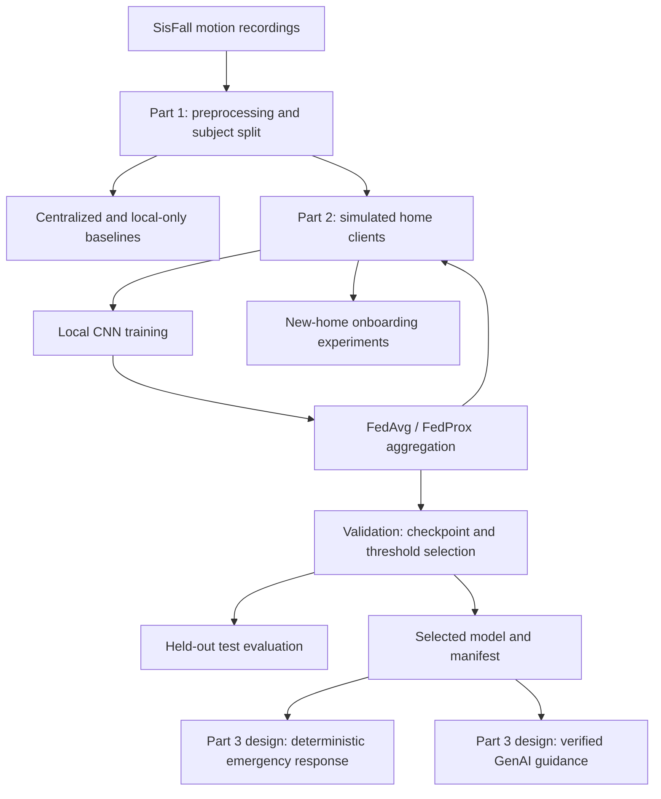

# FallSafe — Elderly Safety System
> A research prototype that uses wearable motion data and federated learning to detect falls and support the safety of older adults living alone.

**Assignment:** Draft a README on GitHub  
**Instructor:** Dr. Jia Uddin  
**Author:** Tanvir Hasan · [GitHub](https://github.com/Tanvir-Hasan-009)

**Status:** Parts 1 and 2 are implemented in `FallSafe_Part1_Part2_Combined.ipynb`. Part 3 is the documented next stage: deterministic emergency response and a separate verified GenAI guidance path. A repository containing only this README is a documentation sample, not a runnable release.

## Problem & Users

Older adults living alone may need assistance after a fall. A useful safety system must distinguish falls from ordinary movement and from activities that resemble falls, such as lying down quickly or stumbling.

A home with no recorded falls cannot easily train its own detector. Pooling everyone's raw sensor data also raises privacy concerns. FallSafe investigates shared learning across homes and how a newly joining home affects the shared detector.

Intended users and stakeholders include older adults, family members and caregivers, and researchers evaluating fall detection and privacy mechanisms. The current implementation evaluates recorded data in a simulation; it does not provide a deployed caregiver alert service.

## Features / Solution

Implemented in Parts 1 and 2:

- Process SisFall accelerometer and gyroscope recordings.
- Classify sensor windows as `normal_adl`, `fall_like_adl`, or `fall`.
- Compare centralized, local-only, FedAvg, and FedProx training.
- Keep training, validation, and test subjects separate.
- Select checkpoints and decision thresholds using validation data.
- Evaluate trial-level fall recall, fall-like alarms, and other false alarms per hour.
- Study newcomer benefit and the effects of onboarding on established homes.
- Evaluate validation gates, clipping, probation, and rollback in applicable onboarding modes.
- Run separate educational secure-aggregation and client-level differential-privacy experiments.
- Export model manifests, checkpoints, figures, and experiment reports.

Part 3 design:

- Restore the selected detector and its frozen threshold.
- Build a deterministic emergency-response path.
- Provide a separate verified GenAI guidance path.

Live notifications, a mobile application, and deployment on physical home devices are not demonstrated by the reviewed Parts 1 and 2 notebook.

## Architecture



One participant represents one simulated home. Standard federation sends model updates and sample counts to the server rather than raw sensor windows. All homes and the server currently run in one Python process, so this is not a distributed deployment.

Onboarding and privacy experiments produce separate research outputs and do not automatically replace the primary detector.

Key project files and generated outputs:

```text
FallSafe/
|-- README.md
|-- FallSafe_Part1_Part2_Combined.ipynb
|-- fallsafe_core.py        # Generated by a notebook cell
|-- fallsafe_fl.py          # Generated by a notebook cell
|-- SisFall.zip             # Supplied separately
`-- artifacts/
    |-- split.json
    |-- models/
    |-- figures/
    `-- part2/
        |-- manifest.json
        |-- manifest_dp.json
        |-- models/
        |-- onboarding/
        |-- secure_agg/
        |-- contribution/
        `-- dp/
```

Generated files appear as their corresponding cells finish. Optional outputs depend on the enabled experiments.

## Prerequisites

- A Python environment supporting PyTorch and Jupyter Notebook.
- `numpy`, `matplotlib`, `torch`, `pandas`, `scipy`, and `cryptography`.
- `dp-accounting` to verify privacy accounting for the DP experiments.
- A local copy of `SisFall.zip`.
- Disk space for processed data, checkpoints, figures, and reports.

The notebook includes CPU-oriented settings. Runtime depends on the hardware and experiment configuration. Expanded onboarding repetitions add substantial training work.

## Installation

This assignment repository currently contains documentation. Once the project notebook is included, clone it and prepare the environment:

```bash
git clone https://github.com/Tanvir-Hasan-009/study-planner-readme-assignment.git
cd study-planner-readme-assignment
python -m venv .venv
```

Activate the environment in Windows PowerShell:

```powershell
.\.venv\Scripts\Activate.ps1
```

Or on macOS/Linux:

```bash
source .venv/bin/activate
```

Install the dependencies:

```bash
python -m pip install notebook numpy matplotlib torch pandas scipy cryptography dp-accounting
```

Place `SisFall.zip` alongside the notebook, or set `SISFALL_ZIP` to its location. Dataset redistribution permissions are separate from code permissions.

These are reproduction instructions for the project files. A README-only repository needs the notebook added separately before the experiments can run.

## Quick Start / Usage

1. Open a terminal in the folder containing the notebook and dataset.
2. Launch Jupyter:

   ```bash
   jupyter notebook FallSafe_Part1_Part2_Combined.ipynb
   ```

3. Select the Python environment containing the dependencies.
4. Review the dataset path and experiment settings.
5. Run the notebook from top to bottom. Part 1 creates the preprocessing cache, subject split, supporting core module, and baseline checkpoints. Part 2 uses those artifacts for federation and onboarding experiments.
6. Inspect the figures and reports under `artifacts/` and `artifacts/part2/`.
7. Inspect `artifacts/part2/manifest.json` for the primary checkpoint and frozen threshold used in the Part 3 handoff.

For a dataset stored elsewhere, configure the path before launching Jupyter. Example for PowerShell:

```powershell
$env:SISFALL_ZIP = "C:\datasets\SisFall.zip"
jupyter notebook FallSafe_Part1_Part2_Combined.ipynb
```

Run from the project folder because generated modules and artifacts use the working directory. Preserve the fixed subject split. Test subjects must not be used to select checkpoints or thresholds.

## Example Output

Generated reports include:

```text
artifacts/part2/manifest.json
artifacts/part2/checks.json
artifacts/part2/execution_status.json
artifacts/part2/budget.csv
artifacts/part2/mcnemar.csv
```

Illustrative summary of the primary manifest:

```text
selected_model: validation-selected FedAvg or FedProx
checkpoint: path to the selected .pt model
decision_threshold: value selected on validation subjects
secure_aggregation_simulated: false
differential_privacy: false
```

This describes the manifest fields, not results from a newly completed run. Read the actual exported manifest for the selected algorithm, threshold, and metrics.

| Metric | Meaning |
|---|---|
| Fall recall | Share of fall trials with a qualifying alarm near impact |
| Fall-like alarm rate | Share of fall-like trials with an alarm near their event |
| Other false alarms per hour | Remaining alarms divided by evaluated recording duration |
| Validation safety cost | Experimental weighted cost used for model selection |
| Onboarding outcomes | Newcomer benefit, established-home effects, and safeguard decisions |

Window accuracy alone does not adequately describe fall detection. The event evaluator is not a measurement of live alert latency.

## Data / Model (for AI projects)

### Dataset and preprocessing

FallSafe uses **SisFall** motion recordings. The pipeline uses six accelerometer and gyroscope channels, reduces sampling from **200 Hz to 50 Hz**, and forms **64-sample windows** with a regular stride of **32 samples**. Each window covers **1.28 seconds**. Additional event windows are used for training.

Physical scaling divides acceleration by `2.0` and gyroscope values by `250.0`, avoiding data-fitted normalization statistics.

| Class | Meaning |
|---|---|
| `normal_adl` | Normal activities of daily living |
| `fall_like_adl` | Selected activities resembling falls, such as quick lying down and stumbling |
| `fall` | Fall events |

The split contains **23 training clients, 5 validation subjects, and 10 test subjects**. SE06, the only older participant who performed falls, is held out in the test set.

### Model and training

`FallCNN` is a one-dimensional CNN with GroupNorm, ReLU, temporal pooling, dropout, and three output classes. Input shape is `[batch, 6, 64]`. Training uses focal loss to address class imbalance.

FedAvg combines local updates with sample-count weights. FedProx adds a local penalty for moving away from the current global model. The comparison uses matched participation schedules and local-training settings.

Checkpoint and threshold selection use validation safety cost:

```text
20 × missed falls + 3 × fall-like alarms + 1 × other false alarms
```

The weights are experimental choices, not clinical constants. The corrected evaluator counts only fall-predicted windows as event evidence, with a 10-second alarm refractory period and an impact interval from 1 second before to 2 seconds after the peak.

### Privacy scope

The primary selected FedAvg/FedProx model uses plain aggregation and is not differentially private. Secure aggregation and client-level DP are studied separately. DP accounting applies only to the specified mechanism and outputs, not to every model and diagnostic released by the notebook.

An optional DP manifest records eligibility and privacy scope. It must be explicitly selected for Part 3; it never silently replaces the primary model.

## Limitations

- University research prototype; not a clinically validated medical device.
- SisFall contains deliberately performed laboratory falls and short scripted activities. Everyday home performance and unplanned falls have not been evaluated here.
- Only one older participant performed falls; that result cannot establish reliability across older adults.
- The small validation cohort contains no older participant with falls.
- Federation executes on one machine without real networking or physical home devices.
- Model updates can leak information; federation alone does not guarantee privacy.
- Secure aggregation is educational and lacks authenticated key distribution, process isolation, and dropout recovery.
- DP uses seeded simulation randomness and has a limited, stated accounting scope.
- Onboarding safeguards use limited data and selected fault scenarios; resistance to subtle poisoning has not been established.
- Part 3 emergency behavior and GenAI guidance require their own implementation and verification. Live alert delivery is not demonstrated by the reviewed notebook.

## Contributing · License · Contact

### Contributing

1. Open an issue describing an improvement or reproducibility problem.
2. Fork the repository and create a branch.
3. Document any changes to preprocessing, splits, thresholds, evaluation, or privacy assumptions.
4. Run relevant verification checks and include supporting results.
5. Submit a pull request explaining the change and its experimental effect.

Keep test subjects out of model selection. Distinguish implemented behavior, measured results, and future work.

### License

No project license is specified. Add a `LICENSE` file before distributing code under an open-source license. Dataset permissions are separate from the code license.

### Contact

**Tanvir Hasan** — [GitHub profile](https://github.com/Tanvir-Hasan-009). Use GitHub Issues for project questions and suggestions.

Prepared for the README assignment provided by **Dr. Jia Uddin**.

